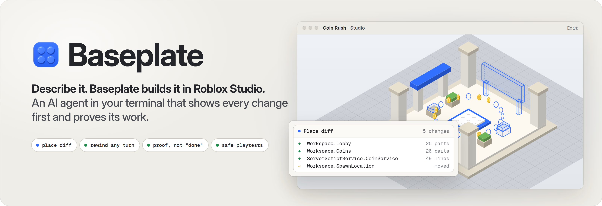
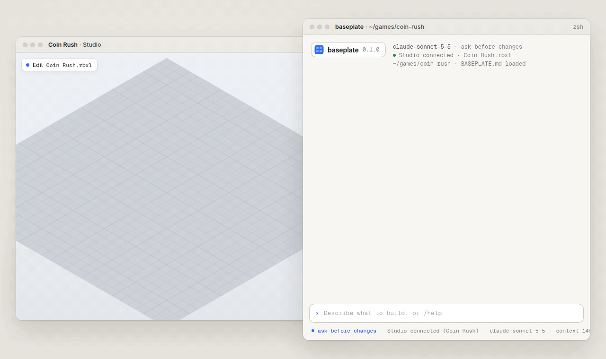
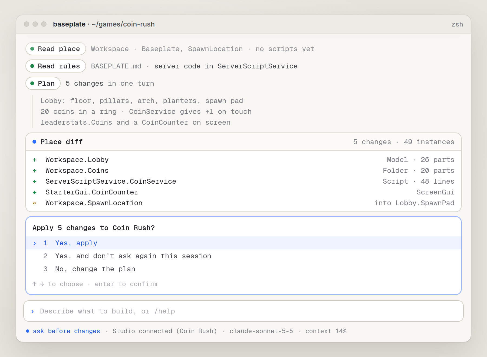
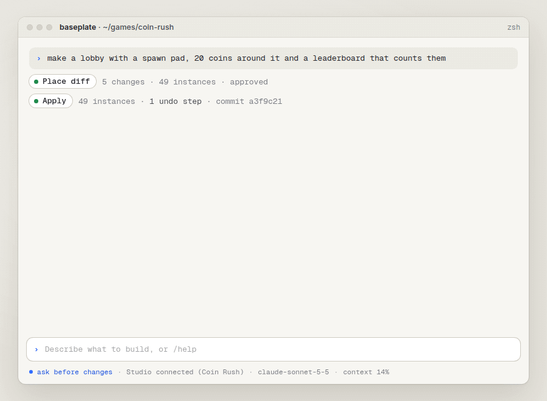
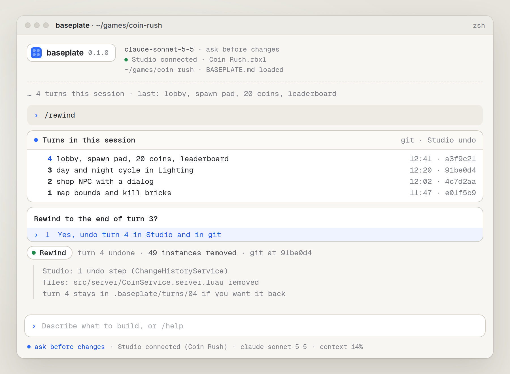
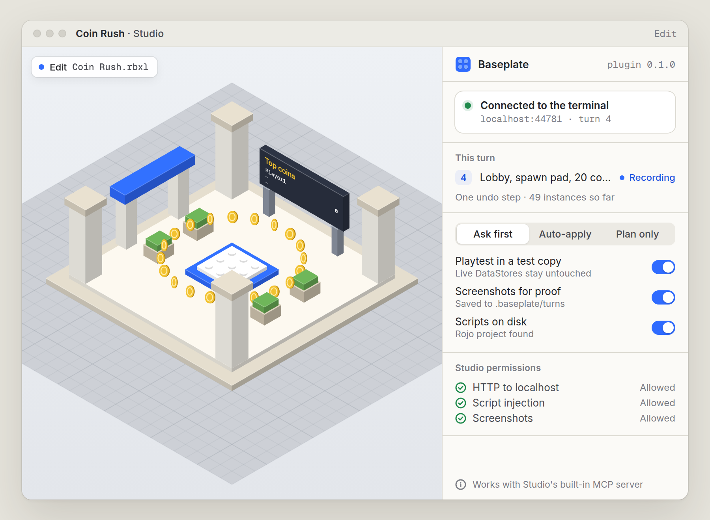

<p align="center">
  
</p>

<p align="center">
  <a href="#install"></a>
  
  <a href="LICENSE"></a>
  
  
  
</p>

<p align="center">
  <a href="#what-it-does">What it does</a> ·
  <a href="#install">Install</a> ·
  <a href="#see-every-change-first">Place diff</a> ·
  <a href="#rewind-any-turn">Rewind</a> ·
  <a href="#proof-not-done">Proof</a> ·
  <a href="#faq">FAQ</a>
</p>

<p align="center">
  
</p>

<h3 align="center">Vibe-code your Roblox game. Like Cursor for Studio, right in your terminal.</h3>

## Your AI said "done". Did you check?

Most AI tools for Roblox write a script, say "done" and leave the bugs to you. **Baseplate shows you every change before it lands, playtests what it built and hands you proof.** Don't like a turn? One Ctrl+Z and it's gone.

**Baseplate is free and open source.** It runs in your terminal and talks to Studio directly. Out of the box it works with a free local model through [Ollama](https://ollama.com). A Claude, GPT or Gemini key is optional, if you already have one. No account, no limits, nothing to buy.

## What it does

<table>
  <tr>
    <td width="50%"></td>
    <td width="50%"></td>
  </tr>
  <tr>
    <td align="center"><sub><b>Place diff.</b> Every instance and script it will touch, before it touches anything</sub></td>
    <td align="center"><sub><b>Proof.</b> It plays the game, reads Output and fixes what broke</sub></td>
  </tr>
  <tr>
    <td></td>
    <td></td>
  </tr>
  <tr>
    <td align="center"><sub><b>Rewind.</b> Jump back to any turn, in Studio and in git</sub></td>
    <td align="center"><sub><b>The plugin.</b> One small panel. You always see what's going on</sub></td>
  </tr>
</table>

## Install

| Download | For |
|---|---|
| [`Diff-1.5.8-portable-x64.exe`](https://github.com/DiplomatHearth/roblox-ai-place-diff/releases/latest/download/Diff-1.5.8-portable-x64.exe) | Windows 10 and 11, one file |

Download and start the exe. No installer, no admin rights.

The build is not code-signed yet, so SmartScreen may warn once: choose **More info**, then **Run anyway**.
| `Baseplate.rbxm` | The Studio plugin, built with Rojo ([build it](#build-from-source)) |

## See every change first

Baseplate reads the place before it plans: the tree, your selection, your scripts and the rules in `BASEPLATE.md`. Then it shows the whole turn as a place diff. `+` is new, `~` is changed, `−` is removed, for instances and for every line of Luau. Nothing reaches Studio until you say yes.

Want it faster? Pick **Yes, and don't ask again this session**, or start with `--mode auto`. Want to think first? `--mode plan` never changes anything.

## Rewind any turn

Every turn is one undo step in Studio. Baseplate wraps it in a single `ChangeHistoryService` recording, so one Ctrl+Z takes back the whole turn: every part, every script, all of it.

In a git project, every turn is also one commit. `/rewind` lists your turns and jumps back to any of them, in Studio and on disk.

## Proof, not "done"

After building, Baseplate plays the game. It reads Output, fixes what broke and plays again until it's clean. Then it shows you a short proof:

- Output errors before and after
- what it checked, for example "leaderboard counts 3 after a test walk"
- a screenshot of the playtest, saved in `.baseplate/turns/`

If it couldn't make something work, it says so. It never reports a turn as done when it isn't.

## Playtests that can't touch live data

Playtests run in a local copy of your place that Baseplate opens in a second Studio window. A local copy can't reach your live DataStores, so a test run never hands out real coins or wipes a real save.

## Also

- **Any model.** A free local model through Ollama by default. Claude, GPT or Gemini if you add your own key.
- **Your code, your way.** It follows your folder layout, your style and your framework, or no framework.
- **Rojo-friendly.** In a Rojo project, scripts land on disk as `.luau` files next to your own.
- **Never publishes on its own.** `/publish` always asks, and `BASEPLATE.md` can turn it off entirely.
- **Private.** No telemetry, no account, no hardware ID. Your place stays on your machine.

| In a session | What it does |
|---|---|
| `/plan` | Plan the next turn without changing anything |
| `/diff` | Show the diff of the last turn again |
| `/playtest` | Play the game now and report |
| `/rewind [turn]` | Go back to the end of an earlier turn |
| `/model` | Switch model mid-session |
| `/rules` | Open `BASEPLATE.md` |

## How it connects

Studio's built-in MCP server already lets an agent read the place, edit scripts, run Luau, start playtests and read Output. Baseplate uses it for all of that. The small Baseplate plugin adds the parts that server doesn't have: one undo step per turn, your current selection, snapshots for the place diff, test-copy playtests and screenshots for the proof. The plugin talks to the terminal over `localhost` only.

See [`examples/BASEPLATE.md`](examples/BASEPLATE.md) for a rules file you can copy.

## Build from source

You need Rust 1.85 or newer. Building the plugin also needs [Rojo](https://rojo.space) 7.7.

```bash
git clone https://github.com/DiplomatHearth/roblox-ai-place-diff.git
cd roblox-ai-place-diff
cargo build --release              # the baseplate command
cargo test --workspace
rojo build plugin -o Baseplate.rbxm
```

| Path | What's inside |
|---|---|
| `crates/baseplate-core` | Place diffs and turn records |
| `crates/baseplate-cli` | The `baseplate` command |
| `plugin/` | The Studio plugin (Luau, built with Rojo) |
| `examples/` | A sample `BASEPLATE.md` |

## FAQ

<details>
<summary><b>Is it free?</b></summary>

Yes, completely. Baseplate is free and open source under the MIT license. It runs on a free local model through Ollama out of the box. If you already have a Claude, GPT or Gemini key you can use it, but you never need one.
</details>

<details>
<summary><b>Why isn't the plugin on the Creator Store?</b></summary>

The plugin runs short checks inside playtests with `loadstring`, which the Creator Store doesn't allow. So it ships with each release, and `baseplate plugin install` puts it in the right folder for you.
</details>

<details>
<summary><b>Can it break my game?</b></summary>

It can make a bad change, like any developer. That's why you see every change first, every turn is one Ctrl+Z, and playtests never touch live data. It never publishes unless you tell it to.
</details>

<details>
<summary><b>Is this made by Roblox?</b></summary>

No. Baseplate is an independent open-source project. It uses Studio's public MCP server and plugin APIs.
</details>

<details>
<summary><b>Is Baseplate like Cursor or Claude Code for Roblox?</b></summary>

That's the idea. Code editors' AI agents only see files. Baseplate sees the place itself through Studio's MCP server: the parts, the UI and the scripts. It builds there, playtests and fixes what breaks. Free with a local model.
</details>

## License

Baseplate is [MIT](LICENSE) licensed. The README images were made with Inter and Geist Mono, both under the SIL Open Font License 1.1 (see [`assets/fonts`](assets/fonts)).

Roblox and Roblox Studio are trademarks of Roblox Corporation. Baseplate isn't affiliated with, endorsed by or sponsored by Roblox.

Cursor and Claude Code are products of Anysphere and Anthropic, named for comparison only. Baseplate isn't affiliated with either.
